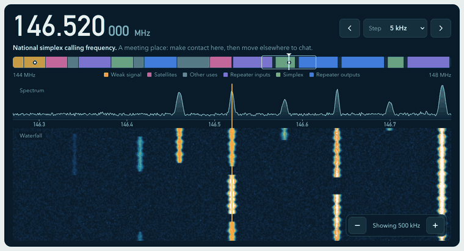
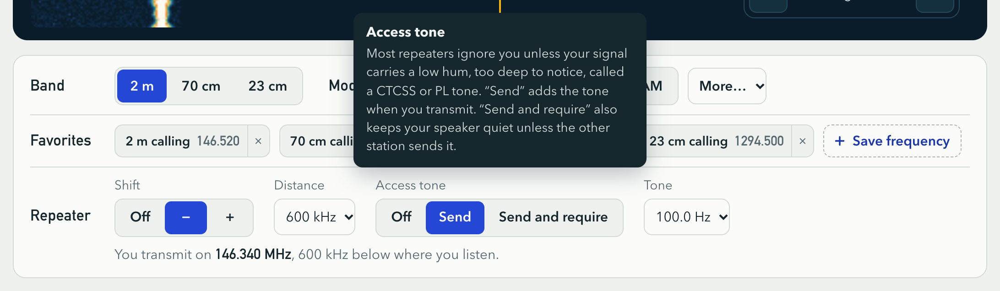
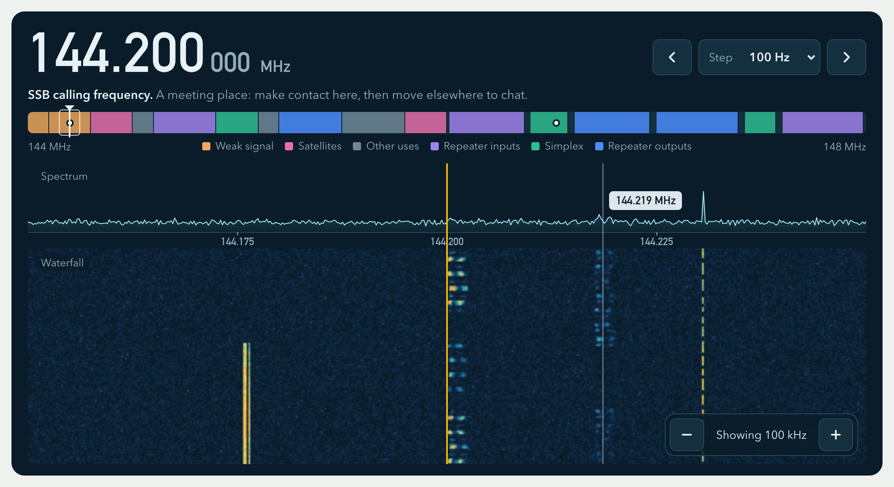
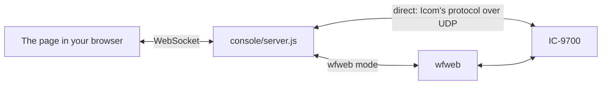

# IC-9700 Web Console


Run an Icom IC-9700 from a browser tab. Tune, watch the band on a live spectrum
and waterfall, listen, and talk, with every control explained in plain language
for people who are new to amateur radio.

It is one small Node.js program with no dependencies and no build step.


> **About the pictures.** The radio was switched off when these were taken, so
> the console was connected to a simulated radio and the signals shown are made
> up. The interface is exactly what you get.

## Contents

- [What you get](#what-you-get)
- [What works today](#what-works-today)
- [What you need](#what-you-need)
- [Set up the radio](#set-up-the-radio)
- [Install and run](#install-and-run)
- [Two ways to reach the radio](#two-ways-to-reach-the-radio)
- [Using it](#using-it)
- [Keeping it safe](#keeping-it-safe)
- [Limits](#limits)
- [Troubleshooting](#troubleshooting)
- [How it works](#how-it-works)
- [Credits](#credits)
- [License](#license)

## What you get

- **A big frequency readout.** Click it to type a frequency, or tune with the
  arrow buttons, the arrow keys, or the scroll wheel.
- **A line that says where you are.** For example, "National simplex calling
  frequency. A meeting place: make contact here, then move elsewhere to chat."
- **A band map.** The ARRL band plan for 2 m, 70 cm and 23 cm as colored
  segments, with the calling frequencies marked. Click anywhere to jump there.
- **Spectrum and waterfall.** Zoom from 1 MHz down to 5 kHz across. Click a
  signal to tune to it.
- **Listen in the browser.** Receive audio, volume, squelch, and a signal meter
  that reads in words ("S9, strong").
- **Talk from the browser.** Hold a button or the space bar and speak into your
  computer's microphone. Power and antenna match (SWR) show while you transmit.
- **Repeaters without the jargon.** Shift, distance and access tone, a button
  that applies the usual settings for that part of the band, and a line that
  tells you exactly where you will transmit.
- **Favorites.** Save a frequency with its mode and repeater settings.
- **Beginner tips on everything.** Point at any control for a short
  explanation. Switch them off when you no longer need them.



| Repeater settings, with a beginner tip showing | Sideband, zoomed in to 100 kHz |
| --- | --- |
|  |  |

## What works today

This is an early project. Read this table before you rely on it.

| Part | State |
| --- | --- |
| Frequency display, band map, spectrum, waterfall, zoom | Used with a real IC-9700, through wfweb |
| Tuning by click, scroll, arrows and typing; favorites; tips | Used with a real IC-9700, through wfweb |
| Receive audio | Reaches the browser from a real IC-9700; sound quality not yet judged |
| Band, mode, repeater, squelch, power, preamp and noise reduction controls | Built; not yet all tried on a real radio |
| Talking from the browser | Built and dry-run with the commands captured; not yet tried on the air |
| Direct connection, without wfweb | Experimental. Passes tests against a simulated radio only |

Developed on macOS 15 (Apple Silicon) with Chrome and Node.js 25. Nothing else
has been tried yet. If you run it somewhere else, an issue saying how it went
is welcome.

## What you need

- **An Icom IC-9700** plugged into your home network with an Ethernet cable.
- **A computer on the same network** with [Node.js](https://nodejs.org) 18 or
  newer. The start script is for macOS and Linux.
- **A current browser.** Chrome is the one that has been used.
- **An amateur radio license to transmit.** Check the rules where you live.

## Set up the radio

Do this once, on the radio's touch screen.

1. Open **MENU » SET » Network**.
2. Note the **IP Address**. Giving the radio a fixed address, or reserving one
   for it in your router, saves you from updating it later.
3. Set a **Network User1 ID** and a **Network User1 Password**.
4. Set **Network Control** to **ON**.
5. Switch the radio off and on again. Network Control does not take effect
   until you do.

## Install and run

```sh
git clone https://github.com/prolonginc/ic9700-web-console.git
cd ic9700-web-console
cp radio.conf.example radio.conf
chmod 600 radio.conf
```

Open `radio.conf` in a text editor and fill in the radio's address and the
login you set above. Then start it:

```sh
./start.sh
```

Your browser opens <http://localhost:9700>. Press Ctrl-C in the terminal to
stop.

`radio.conf` holds your radio's password. Git is told to ignore it, so it stays
out of anything you publish.

## Two ways to reach the radio

Something has to speak the radio's network protocol on the page's behalf. The
`BACKEND` line in `radio.conf` chooses what.

### `BACKEND=wfweb` (the default)

The console goes through [wfweb](https://github.com/adecarolis/wfweb), which
does the talking to the radio. This is the route that has been used with a real
radio.

1. Download wfweb for your computer from its
   [releases page](https://github.com/adecarolis/wfweb/releases).
2. Unzip it inside a folder named `wfweb` in this project, so that the program
   ends up at `wfweb/wfweb-macos-arm64/wfweb`. If yours unpacks under another
   name, set `WFWEB_DIR` in `radio.conf` to the full path of its folder.
3. On macOS, install the libraries wfweb needs:
   `brew install portaudio openssl@4 codec2 qt@5 opus`

`./start.sh` starts wfweb for you and stops it when you quit. wfweb also serves
its own, much fuller page at <https://localhost:8080>, which other devices on
your network can open too. The console links to it as "Full control panel".

### `BACKEND=direct` (experimental)

The console logs in to the radio itself. There is nothing else to install.

This has passed its tests against a simulated radio only. It has not yet been
run against a real IC-9700, so expect rough edges and please report them.

### One connection at a time

The radio accepts a single network connection. Quit wfview, wfweb, RS-BA1 or
anything else that is connected to it before starting the console in direct
mode.

## Using it

| To do this | Do this |
| --- | --- |
| Tune one step | Left and right arrow keys, the arrow buttons, or scroll over the waterfall |
| Go to a frequency | Click the big number, type it in MHz, press Enter |
| Jump within the band | Click the band map |
| Tune to a signal | Click it on the spectrum or the waterfall |
| Zoom | The − and + buttons on the display, or pinch on a trackpad |
| Hear the radio | "Start listening". Browsers only allow sound after a click |
| Transmit | "Set up microphone" once, then hold "Hold to talk" or the space bar |
| Set up a repeater | Tune to its frequency, then "Use the usual repeater settings here" and pick its tone |
| Save where you are | "Save frequency" |
| Close a box or a tip | Esc |

Favorites, volume and your tuning steps are kept in your browser, not in the
radio.

## Keeping it safe

**On the air**

- Nothing is transmitted until you hold the talk button or the space bar.
- Transmission stops if you switch to another tab or window, or close the page.
- It stops by itself after three minutes.
- In direct mode, stopping the console unkeys the radio and logs out.

**On your network**

- The page is served only to the computer it runs on (`127.0.0.1`), and it has
  no login of its own.
- You can change `BIND` in `radio.conf` to serve other devices, but then anyone
  who can open the page can change your radio's settings and key your
  transmitter. Do not put it on the internet.
- From another device, browsers refuse sound and microphone on a plain `http`
  page, so only the display and the controls would work there.
- `radio.conf` stores the radio's password as plain text. Keep it readable only
  by you (`chmod 600 radio.conf`).
- The radio's network protocol scrambles the password rather than encrypting
  it, and it does not encrypt audio. Use it on a network you trust.

## Limits

- **One radio model.** Only the IC-9700 has been used. Other network-capable
  Icom radios speak the same protocol, but none has been tried.
- **United States band plan.** The band map, the "where you are" line and the
  usual repeater settings follow the ARRL plan. Elsewhere they will not match
  your local rules.
- **The everyday controls only.** Radio memories, D-STAR settings, the Morse
  keyer, satellite mode and the rest are left to the radio itself, or to
  wfweb's page.
- **Fonts.** The design uses DIN Alternate and Avenir Next, which come with
  macOS. Other systems fall back to their own fonts.
- **Wide screens.** The layout has only been checked at desktop sizes.
- **An unofficial protocol.** Icom does not publish how its radios talk over
  the network. A firmware update could break this.

## Troubleshooting

**"Can't reach the radio."** Check that the radio is on, that Network Control
is ON and the radio has been switched off and on since, and that the address in
`radio.conf` is right (`ping` it). Make sure nothing else is connected to the
radio.

**The login is refused.** Correct the user ID or password in `radio.conf` and
start again. wfweb does not retry after a wrong password, so it has to be
restarted.

**wfweb stops with `dyld: Library not loaded`.** One of its libraries is
missing. Run the `brew install` line above.

**No sound.** Click "Start listening" first. Then check the volume, and lower
the squelch in case it is set high enough to silence everything.

**The microphone meter stays flat.** Check that your browser has permission to
use the microphone, and which microphone it picked.

**The radio's hand microphone stopped working.** To send your computer's
microphone, the radio's voice input has to be switched to LAN. Direct mode
switches it only while you are talking and puts it back afterward; other
software may leave it there. On the radio, find **DATA OFF MOD** under
**MENU » SET » Connectors** and set it back to MIC.

## How it works



The page sends small JSON commands and receives settings, meter readings,
spectrum sweeps and audio over one WebSocket. The messages are the ones wfweb's
own page uses, so the server can either pass them straight through to wfweb or
answer them itself.

In direct mode the server opens the radio's three UDP streams: control (port
50001), commands (50002) and audio (50003). Commands are Icom's CI-V, the same
ones a serial cable would carry.

```
start.sh                  starts everything
radio.conf.example        settings template
console/
  server.js               serves the page and chooses the backend
  lib/
    direct.js             direct backend: the radio's state as page messages
    wfweb-tunnel.js       wfweb backend: passes the page's WebSocket through
    websocket.js          a small WebSocket server
    icom/
      packets.js          packet layouts of Icom's network protocol
      stream.js           one UDP stream: handshake, pings, resends
      session.js          login, and the control, command and audio streams
      civ.js              CI-V command framing and number formats
      rig.js              settings, meters and the scope, as CI-V commands
      models.js           what is specific to the IC-9700
  public/                 the page: plain HTML, CSS and JavaScript modules
docs/screenshots/         the pictures on this page
```

There is nothing to build. Edit a file under `console/public/` and reload the
page.

## Credits

- [wfview](https://wfview.org) and [wfweb](https://github.com/adecarolis/wfweb)
  showed that this is possible. The page speaks wfweb's message format so that
  it can sit in front of wfweb, and the meter calibration points follow
  wfview's.
- [kappanhang](https://github.com/nonoo/kappanhang) was the main reference for
  the packet layouts of Icom's network protocol.
- The band plan comes from the [ARRL](https://www.arrl.org/band-plan).

The code here was written for this project. None was copied from those
projects.

This project is not affiliated with or endorsed by Icom. Icom and IC-9700 are
trademarks of Icom Inc.

## License

[MIT](LICENSE)
