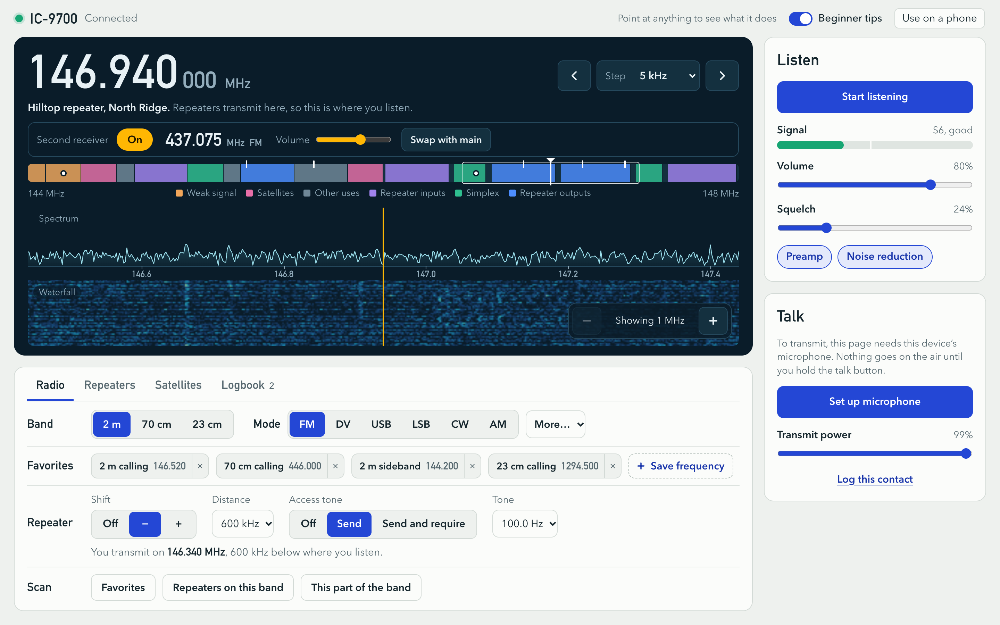
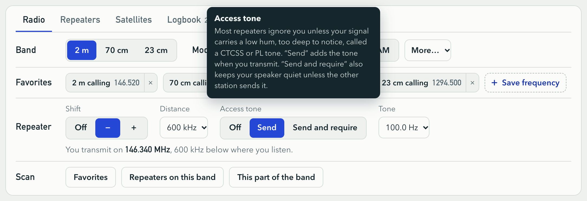
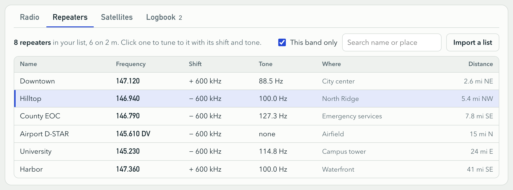
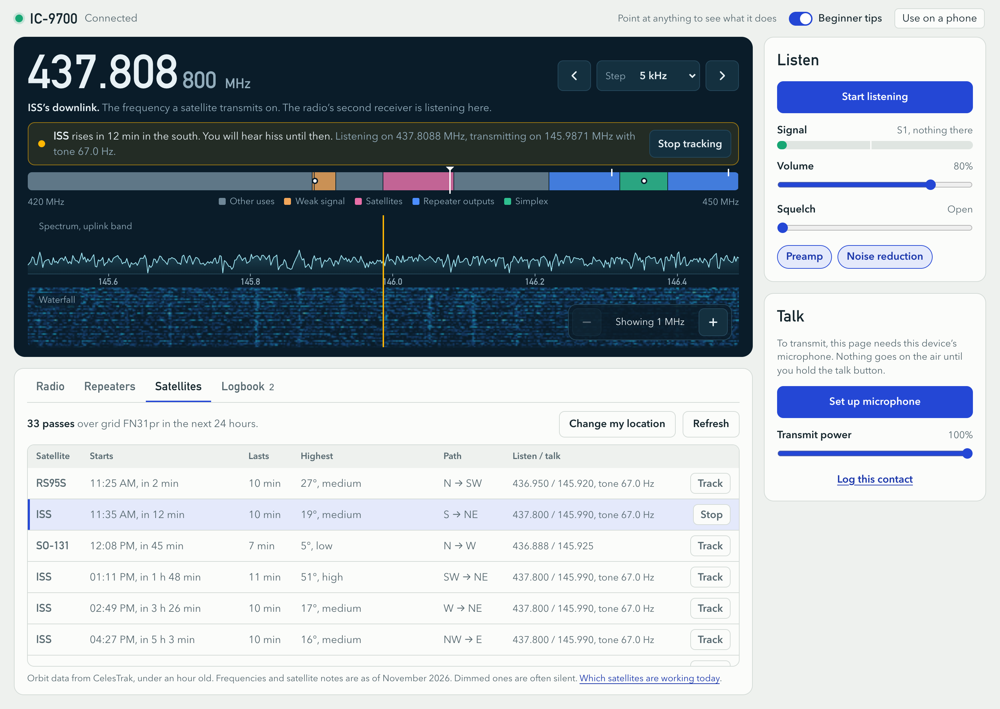
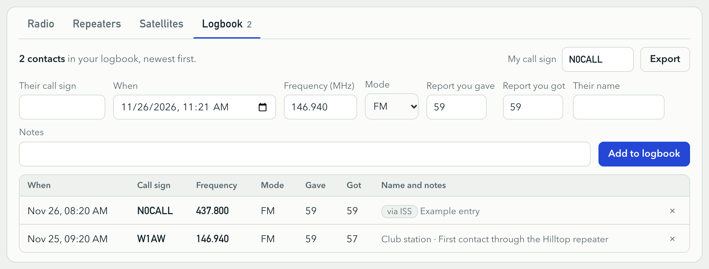
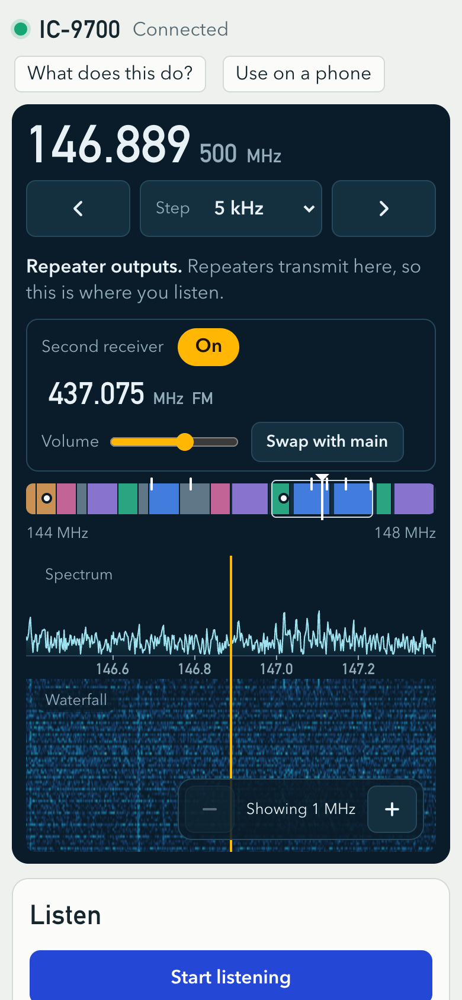
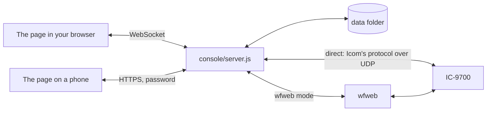

# IC-9700 Web Console


Run an Icom IC-9700 from a browser tab. Tune, watch the band on a live spectrum
and waterfall, listen, talk, scan, follow satellites and keep a logbook, with
every control explained in plain language for people who are new to amateur
radio.

It is one small Node.js program with no dependencies and no build step.



> **About the pictures.** They were taken from a real IC-9700. The repeater
> names, the logbook entries and the location (grid FN31pr) are made-up
> examples.

## Contents

- [What you get](#what-you-get)
- [What works today](#what-works-today)
- [What you need](#what-you-need)
- [Set up the radio](#set-up-the-radio)
- [Install and run](#install-and-run)
- [Using it](#using-it)
- [Repeaters](#repeaters)
- [Satellites](#satellites)
- [Logbook](#logbook)
- [Phones and tablets](#phones-and-tablets)
- [Two ways to reach the radio](#two-ways-to-reach-the-radio)
- [Keeping it safe](#keeping-it-safe)
- [What stays on your computer](#what-stays-on-your-computer)
- [Limits](#limits)
- [Troubleshooting](#troubleshooting)
- [How it works](#how-it-works)
- [Credits](#credits)
- [License](#license)

## What you get

- **A big frequency readout.** Click it to type a frequency, or tune with the
  arrow buttons, the arrow keys, or the scroll wheel.
- **A line that says where you are.** For example, "National simplex calling
  frequency. A meeting place: make contact here, then move elsewhere to chat."
- **A band map.** The ARRL band plan for 2 m, 70 cm and 23 cm as colored
  segments, with the calling frequencies and your own repeaters marked. Click
  anywhere to jump there.
- **Spectrum and waterfall.** Zoom from 1 MHz down to 5 kHz across. Click a
  signal to tune to it.
- **Listen in the browser.** Receive audio, volume, squelch, and a signal meter
  that reads in words ("S9, strong").
- **Talk from the browser.** Hold a button or the space bar and speak into your
  computer's microphone. Power and antenna match (SWR) show while you transmit.
- **Repeaters without the jargon.** Shift, distance and access tone, and a line
  that tells you exactly where you will transmit. Import a list of your local
  repeaters and tune to any of them in one click.
- **Scan.** Step through your favorites, your repeaters or a stretch of band,
  and stop where someone is talking.
- **The second receiver.** Listen on another band at the same time, with its
  own volume.
- **Satellites and the space station.** See when they pass over you, and let
  the console keep the radio on frequency as one goes by.
- **A logbook.** Note who you talked to, and export it for logging sites.
- **On your phone.** Use it from a phone or tablet on your home network, behind
  a password.
- **Beginner tips on everything.** Point at any control for a short
  explanation. Switch them off when you no longer need them.



## What works today

This is an early project. Read this table before you rely on it.

| Part | State |
| --- | --- |
| Display, band map, spectrum, waterfall, tuning, favorites, tips | Used with a real IC-9700 |
| Band, mode, shift, tone, squelch, power, preamp, noise reduction, zoom | Each one changed on a real IC-9700 and read back from it |
| Receive audio | Arrives in the browser from a real IC-9700. Sound quality not yet judged |
| Talking from the browser | Built. Keying, and the automatic unkey, are tested against a simulated radio only. Not yet tried on the air |
| Scan | Steps through channels and reads the squelch on a real radio. It has not yet met a live conversation to stop on |
| Repeater list | Tested with sample files in both formats. A file fresh from RepeaterBook has not been tried |
| Second receiver | Switching on, tuning, swapping and its separate audio checked on a real radio, by measurement rather than by ear |
| Satellites | Predictions checked against published reference values and a live ISS tracker. Tracking sets a real radio up and puts it back. No contact has been made through a satellite yet |
| Logbook | Works. The exported file has not yet been loaded into a logging site |
| Phones and tablets | Tested over HTTPS in a desktop browser at phone size. Not yet on a real phone |

Developed on macOS 15 (Apple Silicon) with Chrome and Node.js 25. Nothing else
has been tried yet. If you run it somewhere else, an issue saying how it went
is welcome.

## What you need

- **An Icom IC-9700** plugged into your home network with an Ethernet cable.
- **A computer on the same network** with [Node.js](https://nodejs.org) 18 or
  newer. The start script is for macOS and Linux.
- **A current browser.** Chrome is the one that has been used.
- **An amateur radio license to transmit.** Check the rules where you live.

## Set up the radio

Do this once, on the radio's touch screen.

1. Open **MENU » SET » Network**.
2. Note the **IP Address**. Giving the radio a fixed address, or reserving one
   for it in your router, saves you from updating it later.
3. Set a **Network User1 ID** and a **Network User1 Password**.
4. Set **Network Control** to **ON**.
5. Switch the radio off and on again. Network Control does not take effect
   until you do.

## Install and run

```sh
git clone https://github.com/prolonginc/ic9700-web-console.git
cd ic9700-web-console
cp radio.conf.example radio.conf
chmod 600 radio.conf
```

Open `radio.conf` in a text editor and fill in the radio's address and the
login you set above. Then start it:

```sh
./start.sh
```

Your browser opens <http://localhost:9700>. Press Ctrl-C in the terminal to
stop.

`radio.conf` holds your radio's password. Git is told to ignore it, so it stays
out of anything you publish. The same goes for the `data` folder, where the
console keeps your favorites, repeater list and logbook.

## Using it

| To do this | Do this |
| --- | --- |
| Tune one step | Left and right arrow keys, the arrow buttons, or scroll over the waterfall |
| Go to a frequency | Click the big number, type it in MHz, press Enter |
| Jump within the band | Click the band map |
| Tune to a signal | Click it on the spectrum or the waterfall |
| Zoom | The − and + buttons on the display, or pinch on a trackpad |
| Hear the radio | "Start listening". Browsers only allow sound after a click |
| Transmit | "Set up microphone" once, then hold "Hold to talk" or the space bar |
| Set up a repeater | Tune to its frequency, then "Use the usual repeater settings here" and pick its tone |
| Save where you are | "Save frequency" |
| Scan | Under **Scan**, pick favorites, repeaters, or this part of the band. "Stop here" stays; "Skip" moves on |
| Listen on a second band | Switch **Second receiver** on and click its frequency to change it |
| Close a box or a tip | Esc |

**Scanning** stops wherever the radio's squelch opens, so set the squelch
first: raise it until the hiss just stops. It waits while a conversation lasts
and moves on four seconds after it ends. It works in FM.

**The second receiver** has to be on a different band from the main one, and it
only listens: you always transmit on the main receiver. If you send the main
receiver to the band the second one is on, the two trade places, as they do on
the radio itself.

## Repeaters



The **Repeaters** tab holds your own list of local repeaters. Once it is
loaded, they appear as marks on the band map, and clicking one tunes to it with
its shift and tone set for you.

To load a list:

1. On [RepeaterBook](https://www.repeaterbook.com), search for repeaters near
   you. Exporting needs a free account there.
2. Export the results as **CHIRP** or **CSV**.
3. In the Repeaters tab, choose **Import a list** and pick the file.

A CHIRP file from any other source works too. Repeaters that use systems this
radio does not have (DMR, System Fusion, P25) are left out, and the import says
how many. Set your location in the Satellites tab and the list is sorted by
distance, when the file includes coordinates.

## Satellites



Amateur satellites and the International Space Station carry repeaters that you
can talk through for the ten minutes or so that they are overhead. The
**Satellites** tab lists the next day's passes over you for the FM voice
satellites: when each starts, how long it lasts, how high it climbs and which
way it travels.

1. Choose **Set my location**. Use the device's location, a grid square such as
   `FN31pr`, or latitude and longitude.
2. Pick a pass and press **Track** a few minutes before it starts.
3. Press **Stop tracking** when you are done. The radio also returns to its
   ordinary frequencies by itself a minute after the satellite sets.

Keep the page open during the pass: it is the page that does the following.

While tracking, the radio is in its satellite mode: it listens on the
satellite's downlink with the second receiver and transmits on the uplink with
the main one, with the access tone set. A satellite moves fast enough to shift
both frequencies by several kilohertz during a pass, and the console keeps
correcting them. The squelch is opened, so you hear hiss until the satellite
comes into range.

Higher passes are easier. Satellites listed dimmed are often switched off, and
all of them come and go: [AMSAT's status page](https://status.amsat.org) shows
what other operators heard today. Satellite contacts are short and busy, so
listen to a few passes before you transmit.

## Logbook



After a contact, press **Log this contact**, type the other station's call
sign, and add it. The time, frequency and mode are filled in from the radio,
and a contact made while tracking is marked with the satellite's name.

**Export** downloads the logbook as an ADIF file, the format that Logbook of
The World, QRZ, eQSL and logging programs import. Put your own call sign in
**My call sign** first, so that it is written into the file.

## Phones and tablets



A phone's browser only lets a page play live sound and use the microphone over
a secure (HTTPS) connection. So for phones, the console opens a second door:
HTTPS, on your home network, behind a password.

1. In `radio.conf`, add a password of at least 8 characters:
   `PHONE_PASS='something-only-you-know'`
2. Restart the console. It prints the address to use, such as
   `https://192.168.1.50:9743`. The **Use on a phone** button on the page shows
   it too.
3. On the phone, on the same Wi-Fi, open that address.
4. The browser warns that it does not recognize the certificate. That is
   expected, because your computer made the certificate itself. Choose to
   continue: "Show Details", then "visit this website" on an iPhone;
   "Advanced", then "Proceed" on Android.
5. Type the password.

On a touch screen there is nothing to point at, so the tips work differently:
tap **What does this do?**, then tap any control to read about it. While that
is on, controls only explain themselves and do nothing else.

**If sound or the microphone will not start on the phone**, install the
console's certificate on it. The sign-in page has the link and the steps. That
certificate is restricted to home-network addresses, so trusting it does not
let anyone pose as another website.

Phone access needs the `openssl` program, which macOS and most Linux systems
already have. Anyone on your network who has the password can change your
radio's settings and key your transmitter, so choose a good one.

## Two ways to reach the radio

Something has to speak the radio's network protocol on the page's behalf. The
`BACKEND` line in `radio.conf` chooses what.

### `BACKEND=direct` (the default)

The console logs in to the radio itself. There is nothing else to install, and
everything on this page works.

### `BACKEND=wfweb`

The console goes through [wfweb](https://github.com/adecarolis/wfweb), which
does the talking to the radio and also serves its own, much fuller page at
<https://localhost:8080>. Scanning, the second receiver and satellite tracking
are not available on this route, and the page hides them. To use it:

1. Set `BACKEND=wfweb` in `radio.conf`.
2. Download wfweb for your computer from its
   [releases page](https://github.com/adecarolis/wfweb/releases).
3. Unzip it inside a folder named `wfweb` in this project, so that the program
   ends up at `wfweb/wfweb-macos-arm64/wfweb`. If yours unpacks under another
   name, set `WFWEB_DIR` in `radio.conf` to the full path of its folder.
4. On macOS, install the libraries wfweb needs:
   `brew install portaudio openssl@4 codec2 qt@5 opus`

`./start.sh` starts wfweb for you and stops it when you quit.

### One connection at a time

The radio accepts a single network connection. Quit wfview, RS-BA1 or anything
else that is connected to it before starting the console. In direct mode that
includes wfweb.

## Keeping it safe

**On the air**

- Nothing is transmitted until you hold the talk button or the space bar.
- Transmission stops if you switch to another tab or window, or close the page.
- It stops by itself after three minutes.
- In direct mode the console also unkeys the radio if your microphone audio
  stops arriving for two seconds, as it would from a phone that lost its Wi-Fi,
  and when the console is stopped.
- Scanning and satellite tracking never transmit. They only tune.

**On your network**

- On its ordinary address the page is served only to the computer it runs on
  (`127.0.0.1`), with no login.
- Requests from other websites open in the same browser are refused, so a page
  elsewhere cannot operate your radio through your browser.
- Phone access is off until you set `PHONE_PASS`. It uses HTTPS and asks for
  that password, and five wrong tries from a device pause sign-in from it for a
  minute.
- `BIND` in `radio.conf` can serve the plain page to other devices with no
  password at all. Phone access is the safer way to do that.
- Do not put any of this on the internet.
- `radio.conf` stores the radio's password, and the phone password, as plain
  text. Keep it readable only by you (`chmod 600 radio.conf`).
- The radio's network protocol scrambles the password rather than encrypting
  it, and it does not encrypt audio. Use it on a network you trust.

## What stays on your computer

Your favorites, repeater list, logbook, call sign and location are files in the
`data` folder next to `radio.conf`. Nothing reads them but the console.

The console contacts one outside service: it downloads satellite orbit data
from [CelesTrak](https://celestrak.org), at most once every two hours, and only
once you have set a location for the Satellites tab. The request carries
nothing about you. Passes are worked out on your computer, so your location is
never sent anywhere.

## Limits

- **One radio model.** Only the IC-9700 has been used. Other network-capable
  Icom radios speak the same protocol, but none has been tried.
- **United States band plan.** The band map, the "where you are" line and the
  usual repeater settings follow the ARRL plan. Elsewhere they will not match
  your local rules.
- **FM satellites only.** Satellites that carry sideband and Morse (the
  "linear" ones, such as RS-44) are not listed. The satellite list and its
  frequencies are as of November 2026 and will go out of date.
- **The second receiver is a listener.** Its signal meter, mode and other
  settings are left to the radio; the page tunes it, sets its volume and
  swaps it with the main one.
- **The everyday controls only.** Radio memories, D-STAR settings, the Morse
  keyer and the rest are left to the radio itself, or to wfweb's page.
- **Fonts.** The design uses DIN Alternate and Avenir Next, which come with
  macOS. Other systems fall back to their own fonts.
- **An unofficial protocol.** Icom does not publish how its radios talk over
  the network. A firmware update could break this.

## Troubleshooting

**"Can't reach the radio."** Check that the radio is on, that Network Control
is ON and the radio has been switched off and on since, and that the address in
`radio.conf` is right (`ping` it). Make sure nothing else is connected to the
radio.

**The login is refused.** Correct the user ID or password in `radio.conf`, then
stop the console and start it again. Neither route retries after a wrong
password.

**No sound.** Click "Start listening" first. Then check the volume, and lower
the squelch in case it is set high enough to silence everything.

**The microphone meter stays flat.** Check that your browser has permission to
use the microphone, and which microphone it picked.

**The radio's hand microphone stopped working.** To send your computer's
microphone, the radio's voice input has to be switched to LAN. Direct mode
switches it only while you are talking and puts it back afterward; other
software may leave it there. On the radio, find **DATA OFF MOD** under
**MENU » SET » Connectors** and set it back to MIC.

**A scan stops at once, or says every channel looks busy.** The squelch is
open. Raise it until the hiss stops, then scan again.

**The 70 cm button swapped my two receivers.** The second receiver was on that
band, and a band can only be on one receiver at a time. Switch the second
receiver off if you want the main one to roam freely.

**No satellite passes are listed.** Set your location first. If it says the
orbit data could not be fetched, the computer needs to reach celestrak.org;
the console tries again later by itself.

**The radio is stuck in satellite mode.** Press "Leave satellite mode" at the
top of the display, or switch satellite mode off on the radio.

**The phone cannot open the address.** Check that it is on the same network as
the computer, that the console printed a "Phone or tablet" line when it
started, and that the computer's firewall allows incoming connections to Node.

**In wfweb mode, wfweb stops with `dyld: Library not loaded`.** One of its
libraries is missing. Run the `brew install` line above.

## How it works



The page sends small JSON commands and receives settings, meter readings,
spectrum sweeps and audio over one WebSocket. The messages are the ones wfweb's
own page uses, so the server can either pass them straight through to wfweb or
answer them itself. Direct mode adds a few of its own for the second receiver,
scanning and satellites.

In direct mode the server opens the radio's three UDP streams: control (port
50001), commands (50002) and audio (50003). Commands are Icom's CI-V, the same
ones a serial cable would carry. Audio is asked for in stereo, which the radio
uses to send its two receivers separately.

Satellite positions come from SGP4, the standard orbit model, written out in
`console/public/js/sgp4.js` and checked in the tests against the reference
results published with it.

```
start.sh                  starts everything
radio.conf.example        settings template
console/
  server.js               serves the page, the API, and phone access
  lib/
    direct.js             direct backend: the radio's state as page messages
    wfweb-tunnel.js       wfweb backend: passes the page's WebSocket through
    websocket.js          a small WebSocket server
    api.js                favorites, repeaters, logbook, orbit data
    store.js              the data folder
    adif.js               logbook export
    phone.js              HTTPS certificate and sign-in for phones
    guard.js              refuses requests from other websites
    icom/
      packets.js          packet layouts of Icom's network protocol
      stream.js           one UDP stream: handshake, pings, resends
      session.js          login, and the control, command and audio streams
      civ.js              CI-V command framing and number formats
      rig.js              settings, meters, both receivers, satellite mode
      models.js           what is specific to the IC-9700
  public/                 the page: plain HTML, CSS and JavaScript modules
    js/sgp4.js            where a satellite is
    js/passes.js          when it is overhead
    js/satdata.js         the satellite list and its frequencies
test/                     run with: npm test
docs/screenshots/         the pictures on this page
```

There is nothing to build. Edit a file under `console/public/` and reload the
page. `npm test` runs the checks that need no radio.

## Credits

- [wfview](https://wfview.org) and [wfweb](https://github.com/adecarolis/wfweb)
  showed that this is possible. The page speaks wfweb's message format so that
  it can sit in front of wfweb, the meter calibration points follow wfview's,
  and wfview's radio definitions were the reference for the commands that work
  the second receiver and satellite mode.
- [kappanhang](https://github.com/nonoo/kappanhang) was the main reference for
  the packet layouts of Icom's network protocol.
- The band plan comes from the [ARRL](https://www.arrl.org/band-plan).
- Orbit data comes from [CelesTrak](https://celestrak.org). The orbit model
  follows Vallado, Crawford, Hujsak and Kelso, "Revisiting Spacetrack Report
  #3" (2006).
- Satellite frequencies come from [AMSAT](https://www.amsat.org) and
  [ARISS](https://www.ariss.org).
- The repeater importer reads the CSV formats of
  [CHIRP](https://chirpmyradio.com) and
  [RepeaterBook](https://www.repeaterbook.com).

The code here was written for this project. None was copied from those
projects.

This project is not affiliated with or endorsed by Icom, AMSAT, CelesTrak or
RepeaterBook. Icom and IC-9700 are trademarks of Icom Inc.

## License

[MIT](LICENSE)
